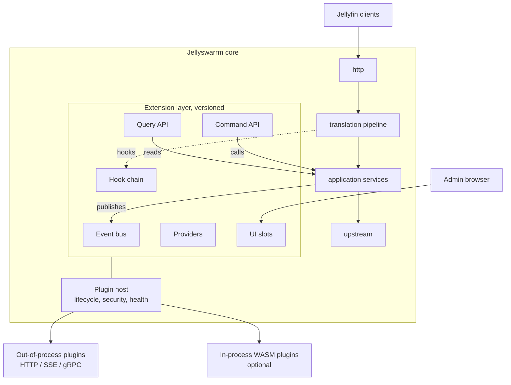
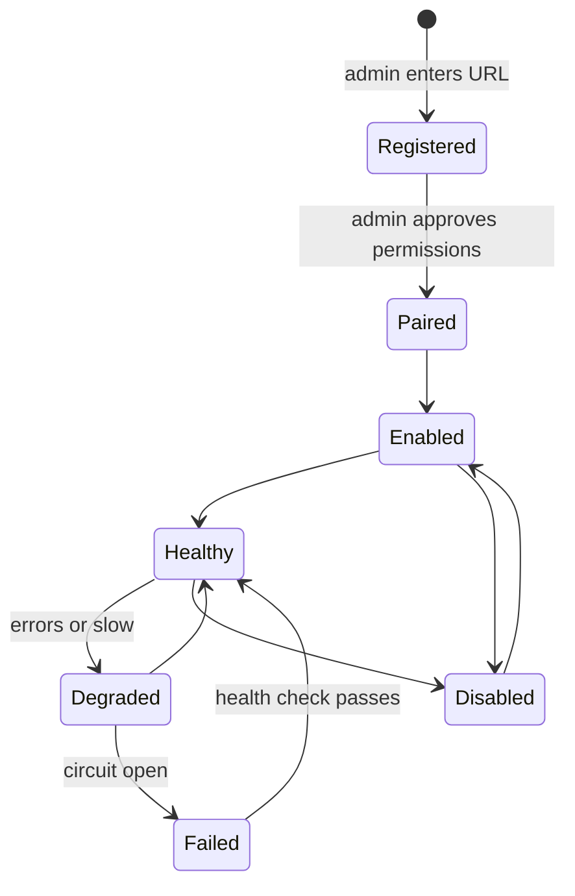

# Plugin system v2: proposal

> Status: proposal. Nothing here is implemented. The decision behind it is
> [0008 Core-owned extension layer](decisions/0008-core-owned-extension-layer.md).

v1 was built under one constraint: touch as little core code as possible, so the
fork stays easy to rebase ([0007](decisions/0007-fork-hygiene.md)). v2 drops that
constraint. It describes a plugin system designed to live in upstream
Jellyswarrm, with extension points owned by the core.

File paths refer to the current upstream layout (`application/`, `translation/`,
`persistence/`, `startup/`, `client_sessions/`).

## Why v2

The v1 constraint has these costs:

| Limitation in v1 | Effect |
|---|---|
| Read-only API | Plugins can't act: no messages, no stopping playback, no user management. |
| No request hooks | Plugins can't change behaviour, such as filtering or adding items. |
| Events published from one place (`observe_playback`) | Clients that vanish produce no stop event; no session, login or server events. |
| One shared, permanent secret per plugin | No per-permission limits, no rotation, no acting as a user. |
| Plugin pages on the admin's origin | Plugin JavaScript can use the admin session, so every plugin must be fully trusted. |
| Config in `jellyswarrm.toml` | No lifecycle, no stored state, no settings UI. |

## Principles

* **No plugins, no change.** Every extension point does nothing by default.
  Without plugins, Jellyswarrm behaves exactly as before.
* **The core owns the contract.** Extension points are typed and declared in the
  core, not added next to it.
* **A plugin can't break playback.** Time limits, circuit breakers and bounded
  queues around every plugin call. Failing plugins are skipped, not waited for.
* **Least privilege.** Plugins get only the permissions an admin approved.
* **Stable and versioned.** Plugins depend on a published contract, never on
  internal types.

## Concepts

The extension points are **building blocks, not plugin types**. One plugin can
use several of them; the viewer, for example, uses the event bus, the Query API
and a UI page. A plugin lists the blocks it uses, and the permissions it needs,
in its manifest.

| Block | Who starts it | Does the core wait? | Can it change behaviour? | Example |
|---|---|---|---|---|
| Event bus | Core | No | No, it is told what happened | Viewer shows who is watching |
| Query API | Plugin | – | No, read only | List servers, users, sessions, movies |
| Command API | Plugin | – | Yes, through the core's normal actions | Send a message to a client, stop playback |
| Hook chain | Core, on client requests | Yes, with a time limit | Yes, it changes requests and responses | Hide movies above PG-13 for kids |
| Providers | Core | Yes | Yes, the core uses the plugin's answer | Log in with OIDC; pick which server plays a movie |
| Scheduled tasks | Host, on a timer | No | Whatever the job does through the APIs | Nightly cleanup |

* **Event bus:** the core publishes events at chosen moments ("playback
  started", "session ended", "login failed"), not on every function call.
  Plugins get a curated, stable payload, never the raw function arguments.
* **Query API and Command API:** called by the plugin's backend with its token,
  not by the admin's browser. Both cover system data (servers, users, sessions)
  and media data (libraries, items in Jellyswarrm's merged view). Commands go
  through the same logic and permission checks as the admin UI.
* **Hook chain vs. providers:** a hook can rewrite anything in a request or
  response. A provider answers one narrow, typed question the core asks. Use a
  provider when one fits; it is safer and easier to write.
* **Providers vs. events:** for an event, the core doesn't wait. For a
  provider, the core waits for the answer and uses it.

## Architecture



## 1. Extension points

### Event bus

An `EventBus` in `application/` that the core always publishes to, whether or
not plugins are configured. The plugin bridge is one subscriber among others
(health monitoring could be another).

| Event | Source |
|---|---|
| `session.started`, `session.ended` (reason: `logout`, `timeout`, `disconnected`) | `client_sessions/` |
| `playback.started`, `playback.progress`, `playback.stopped` | `application/playback/` |
| `user.login`, `user.login_failed` | `auth/` |
| `server.health_changed` | server health checks |
| `library.changed` | `libraries/` |
| `config.changed` | admin settings |

Events carry an ID and a timestamp. The bus keeps a short replay buffer, so a
plugin that reconnects with `Last-Event-ID` catches up instead of losing events.
Delivery stays best effort beyond that buffer; `stream.lagged` remains.

`session.ended` fixes the v1 gap where closing a browser tab never produced a
stop event.

### Query API

Read-only access built on the application services, never on internal types:
sessions, users, servers, libraries, items, playback history. Responses are
DTOs with their own schema, as in v1.

### Command API

Write actions that go through the same application services and authorization
checks as the admin UI:

* send a message to a session, stop or pause playback
* create, disable or update users
* trigger a library refresh

Every command needs a permission and is written to the audit log.

### Hook chain

Interceptors in `translation/pipeline.rs`:

* `before_forward`: inspect or change a request before it goes upstream.
* `after_response`: inspect or change a response before it goes to the client.

Rules:

* A plugin declares the routes it hooks (for example `items.list`). Other
  requests never reach it.
* Hooks run in a fixed order (by priority, then plugin ID).
* Each hook has a time limit set by the core. On timeout or error, the hook's
  policy decides: `skip` (the default) or `block`.
* Hooks that run on every response should use the WASM runtime (section 4),
  because a network call per request is too slow.

### Providers

Typed interfaces for common needs. They are safer and simpler for plugin
authors than raw hooks:

| Provider | Example |
|---|---|
| `NotificationSink` | Send playback or login events to Discord, ntfy, email. |
| `AuthProvider` | OIDC or LDAP login mapped to Jellyswarrm users. |
| `LibraryProvider` | Virtual collections, per-user filtering. |
| `MetadataEnricher` | Add ratings or tags to items. |
| `ServerSelector` | Pick which server plays an item that exists on several servers, for example by priority, load or location. |

Inside the core, each provider is a trait with a no-op default. A plugin
adapter implements it by calling the remote plugin.

### Scheduled tasks

Plugins register jobs (cron expression plus endpoint). The host runs them,
records the result and shows it in the admin UI.

## 2. Plugin host

### Lifecycle



### State

Plugin state lives in the database, added through normal migrations in
`crates/jellyswarrm-proxy/migrations/`:

* registration (ID, URL, runtime)
* manifest snapshot and version
* granted permissions
* configuration (validated against the plugin's `config_schema`)
* credentials (encrypted, like server credentials today)
* status and last error

`[[plugins]]` in `jellyswarrm.toml` remains supported for automated setups and
is imported on startup.

### Pairing

1. The admin enters the plugin URL in the admin UI.
2. The host fetches `manifest.json` and shows the requested permissions.
3. The admin approves them.
4. The host issues the plugin's credentials and sends them to the plugin's
   pairing endpoint.

### Reliability

* A time limit on every call to a plugin.
* A circuit breaker per plugin: after repeated failures, calls are skipped until
  a health check passes.
* Bounded queues for events and webhooks; a slow plugin loses events, it never
  delays the proxy.
* Health checks with backoff.

## 3. Manifest v2

```json
{
  "id": "viewer",
  "version": "1.2.0",
  "api": ">=2.0 <3",
  "permissions": ["sessions:read", "events:playback", "playback:control"],
  "provides": {
    "events": ["playback.*", "session.*"],
    "hooks": [],
    "providers": ["NotificationSink"],
    "jobs": [{ "name": "cleanup", "schedule": "0 3 * * *" }],
    "ui": [{ "slot": "admin.page", "title": "Now playing", "icon": "fa-tv", "entry": "index.html" }]
  },
  "config_schema": { "type": "object", "properties": { "timeout_s": { "type": "integer", "default": 60 } } },
  "health": "/health"
}
```

* `api` is a version range instead of a single number. The host picks the
  newest version both sides support.
* The admin UI builds the plugin's settings form from `config_schema`.

## 4. Runtimes

| | Out-of-process (default) | WASM (optional) |
|---|---|---|
| Language | Any | Anything that compiles to WASM components |
| Transport | HTTP + SSE, or gRPC | Direct calls, typed interface definitions |
| Isolation | Own process or container | Sandbox with memory and CPU limits |
| Latency | Network round trip | Microseconds |
| Good for | Events, queries, commands, providers, UI, jobs | Hooks on every request or response |

Start with out-of-process only. Add WASM (wasmtime) once a hook plugin needs it.

## 5. Security

* **Own identity per plugin.** Short-lived tokens issued by the host, limited to
  the approved permissions, rotatable and revocable. They replace the permanent
  shared secret from [0004](decisions/0004-auth-tokens.md).
* **Acting on behalf of a user.** A user-facing plugin gets a token with that
  user's rights, never admin rights.
* **UI isolation.** Plugin pages run in a sandboxed iframe on a separate origin
  with a strict Content Security Policy. They talk to the host through a small
  `postMessage` bridge with a limited token. This replaces the same-origin model
  from [0006](decisions/0006-ui-via-reverse-proxy.md), so plugin JavaScript can
  no longer use the admin session.
* **Audit log** of every command and every hook that changed a request or
  response.
* **Data minimization.** DTOs never contain passwords, tokens or server URLs.

## 6. UI

* A plugins page in the admin UI: pair, approve permissions, configure through
  the generated form, enable or disable, view status, errors and job results.
* UI slots: `admin.page` (a tab, as in v1), `admin.dashboard` (a widget), and
  later `user.page` for regular users.

## 7. Versioning and developer experience

* The plugin API follows semver. Several major versions can be supported at the
  same time, with an announced deprecation period.
* An OpenAPI spec and event schemas are published; client libraries for Rust,
  Python and TypeScript are generated from them.
* A **mock host** for local development and a **conformance test suite** that
  plugin authors can run in CI.
* Example plugins: viewer (events, UI), notifier (provider), library filter
  (hook).

## 8. Observability

Per plugin: call latency, error rate, event backlog, circuit breaker state, job
results. Shown next to the existing server health monitoring
([health-monitoring.md](../health-monitoring.md)) and exposed as metrics.

## Distribution

Installing a plugin means running its container and pairing it. Jellyswarrm
does not manage containers, so it never needs access to the Docker socket. An
optional catalog of signed releases can come later.

## Migration from v1

* v1 plugins keep working: `/plugin-api/v1` stays available through a
  compatibility layer on top of the v2 Query API and event bus.
* `[[plugins]]` entries are imported into the database on startup, with
  read-only permissions matching v1.
* The viewer plugin is ported to v2 as the reference example.

## Roadmap

Each step is useful on its own and leaves Jellyswarrm working.

| Step | Content | Done when |
|---|---|---|
| 1 | Event bus in the core with session, playback, login and server events | `session.ended` is emitted when a tab is closed; no behaviour change without plugins |
| 2 | Plugin host: database state, pairing, limited tokens, v1 compatibility layer | The viewer runs unchanged; a v2 plugin pairs through the admin UI |
| 3 | Command API with permissions and audit log | A plugin can send a message to a session only if the permission was granted |
| 4 | Isolated UI slots and generated settings form | A plugin page can't read the admin session cookie or call the admin UI |
| 5 | Providers, starting with `NotificationSink` | A notifier plugin sends playback events to ntfy |
| 6 | Hook chain; WASM runtime if latency requires it | A filter plugin hides items; a timed-out hook doesn't delay the response |

## Core changes

| Area | Change |
|---|---|
| `application/` | `EventBus`; publish calls in playback, sessions, auth, server health; command entry points |
| `translation/pipeline.rs` | Hook chain with no-op default |
| `auth/`, `libraries/` | Provider traits with no-op defaults |
| `persistence/`, `migrations/` | Plugin tables |
| `startup/composition.rs` | Build the extension registry and plugin host |
| `ui/` | Plugins page, settings form, UI slots |
| `http/router.rs` | Mount `/plugin-api/v1` and `/plugin-api/v2` |

## Open questions

* Is the upstream maintainer interested in a plugin system in the core? If not,
  v2 is too large to keep as a fork.
* gRPC alongside HTTP, or HTTP only?
* Webhooks as a second delivery mode for events, for plugins that can't keep a
  connection open?
* Which providers are wanted first besides notifications?
